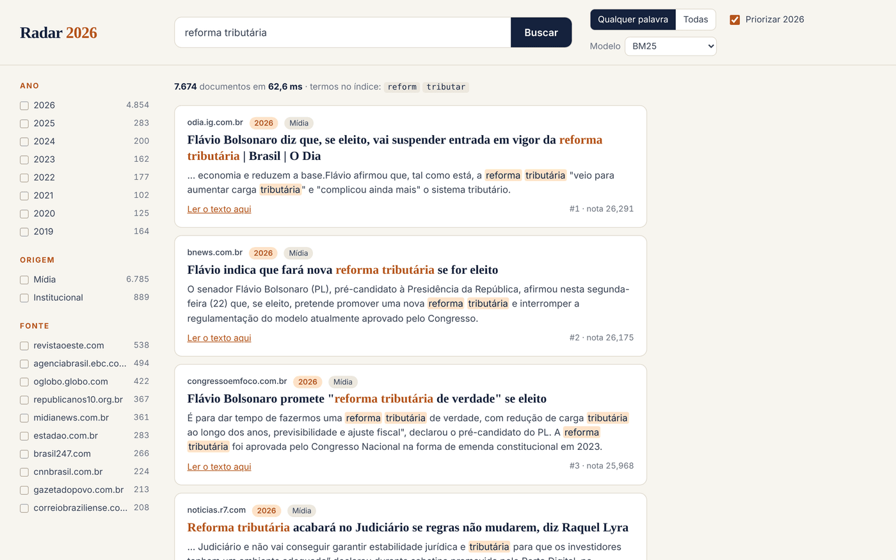
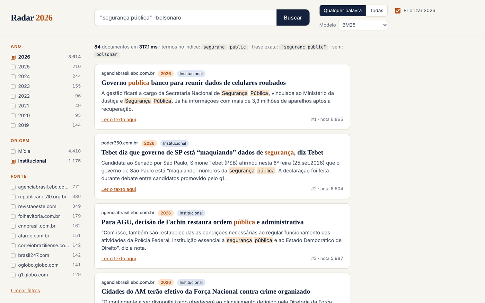
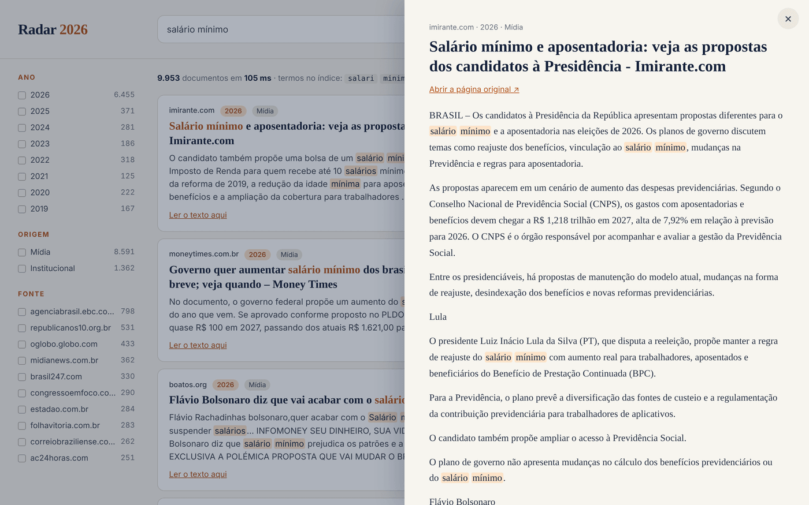

# Radar 2026

Buscador de notícias, propostas e planos de governo das Eleições 2026, desenvolvido como trabalho acadêmico de uma disciplina de Recuperação de Informação na Web.

O projeto cobre o ciclo completo de um sistema de busca, **sem banco de dados**:

1. **Coleta:** coletores feitos com o pyspider percorrem portais de notícia e sites institucionais e guardam as páginas sobre propostas e eleições. A fila de URLs e os resultados ficam em arquivos.
2. **Representação:** os textos são limpos, quebrados em palavras e normalizados (stopwords, stemming em português, remoção de acentos). O índice invertido é construído em blocos (SPIMI), comprimido (d-gap + Variable Byte), dividido em 64 buckets e guarda as posições das palavras.
3. **Recuperação:** ranqueamento BM25, busca por frase exata, exclusão de termos, filtros por ano, origem e fonte, e trechos com os termos destacados.
4. **Interface:** página web local servida pelo próprio Python, sem frameworks.
   

## Telas

Busca por "reforma tributária": filtros por ano, origem e fonte à esquerda, com a contagem de documentos, e trechos com os termos destacados.



| Frase exata, exclusão e filtros | Leitura do texto completo |
| --- | --- |
|  |  |

| Tela inicial | No celular |
| --- | --- |
|  |  |


## Como rodar

Requisitos: Python 3.8 ou mais novo.

```
pip install -r requirements.txt
python indexar.py --csv corpus.csv preparar      # limpa os textos (uma vez)
python indexar.py --csv corpus.csv construir     # monta o índice (uma vez)
python buscador.py                               # abre http://localhost:8026
```

**Os dados coletados não estão no repositório**, por causa do tamanho e porque os textos pertencem aos sites de origem. Para gerar um corpus próprio, rode os coletores da pasta `coleta_etapa1/` (veja o `README.md` de cada um). O arquivo de entrada é um CSV com as colunas `id`, `url`, `titulo`, `texto`, `fonte`, `tipo` e `data_publicacao`.

## Consultas

- `reforma tributária`: qualquer uma das palavras (ou todas, pelo seletor da interface)
- `"segurança pública"`: frase exata
- `saúde -dengue`: exclui um termo

No terminal: `python indexar.py buscar "reforma tributária" --ano 2026`.

## Estrutura

| Caminho | Função |
| --- | --- |
| `coleta_etapa1/` | coletores pyspider, com fila e resultados gravados em arquivos |
| `unificar_bases.py` | junta as bases das duas frentes de coleta num CSV |
| `indexar.py` | linha de comando: preparar, construir, experimentos, buscar, info |
| `riw_indice/preproc.py` | limpeza, tokens, stopwords, stemming |
| `riw_indice/corpus.py` | leitura do CSV, descarte de páginas inúteis, armazém de textos |
| `riw_indice/construtor.py` | SPIMI, fusão k-way, buckets, índice posicional |
| `riw_indice/codificacao.py` | compressão d-gap + Variable Byte |
| `riw_indice/leitor.py` | acesso ao índice em disco |
| `riw_indice/busca.py` | BM25, frase exata, filtros, reordenação e trechos |
| `buscador.py` + `web/` | servidor web local e interface |
| `avaliar.py` | avaliação do ranqueamento (MRR, Acerto@1, Acerto@10) e tempos |
| `resultados/` | resultados dos experimentos e da avaliação |

## Licença

MIT. Veja o arquivo `LICENSE`.
